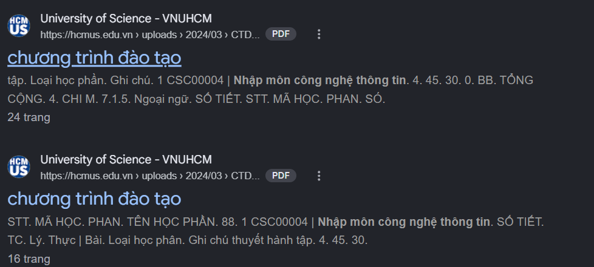

# Viết một chuỗi truy vấn (Query) sử dụng toán tử filetype:, site: và dấu ngoặc kép " " để tìm trực tiếp tệp tin PDF trên máy chủ của trường.
```
"Nhập môn công nghệ thông tin" filetype:pdf site:edu.vn -hocphi -danhmuc
```
- Toán tử filetype:pdf giúp hiện thị các trang web chứa file pdf loại bỏ các thông tin dư thừa vì vậy giúp tìm kiếm chính xác hơn.
